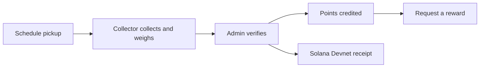

<p align="center">
  
</p>

<h1 align="center">BottleUp</h1>

<p align="center">Turn plastic pickups into verified recycling and rewards.</p>

<p align="center">
  <a href="https://github.com/JayHermes/Bottleup/actions/workflows/bottleup-build.yml"></a>
  
  
  
</p>

<p align="center">
  <a href="https://usebottleup.xyz">Open BottleUp</a> ·
  <a href="docs/README.md">Documentation</a> ·
  <a href="docs/getting-started.md">Get started</a>
</p>

BottleUp helps households schedule plastic recycling pickups, connects them with collectors, and rewards recycling after an administrator verifies the collected weight. Verified pickups can also receive a Solana receipt.

**Website:** [usebottleup.xyz](https://usebottleup.xyz) · **Blockchain:** Solana Devnet · **Stack:** React, Vite, Supabase, Leaflet, Anchor

## How it works



1. A user selects a material, estimates the quantity, enters a landmark, and optionally adds a map pin and photo.
2. A collector accepts the pickup, shares their location, and records the collected weight.
3. An administrator verifies the pickup. The database credits **100 points per verified kilogram**, once per pickup.
4. A server-side function records a receipt on Solana Devnet. The user can open it in Solana Explorer.
5. Users redeem points against the reward catalog. The team handles reward fulfilment manually.

Solana receipts record an authorized recycling attestation. They do not independently prove physical recycling. Personal addresses, contact details, and photographs stay off-chain.

## Run locally

Use **Node.js 24** and npm for the full test suite.

```sh
cd bottle-up-mvp
npm ci
cp .env.example .env
# Fill in your Supabase project URL and publishable key in .env.
npm run dev
```

Open the URL printed by Vite. Landing and authentication screens render without backend credentials; account operations need a configured Supabase project. Maps use OpenStreetMap tiles without an API key. GPS needs HTTPS or localhost and browser permission.

```sh
# From the repository root:
npm --prefix bottle-up-mvp test
npm --prefix bottle-up-mvp run build
```

For a new backend, follow [Getting started](docs/getting-started.md). Solana tooling is only needed to build or deploy the on-chain program, not to run the frontend.

## Documentation

| Guide | Contents |
| --- | --- |
| [Documentation index](docs/README.md) | All guides and suggested reading order |
| [Getting started](docs/getting-started.md) | Environment variables, database setup, local development |
| [Architecture](docs/architecture.md) | Roles, pickup lifecycle, database boundaries, receipt flow |
| [User guide](docs/user-guide.md) | User, collector, and administrator workflows |
| [Deployment and operations](docs/deployment.md) | Frontend/backend configuration, rollout checks, troubleshooting |
| [Testing](docs/testing.md) | Automated tests, local validator, manual release checks |
| [Solana receipts](solana-verification/README.md) | Program identity, build, deployment, signing, retry recovery |
| [Points system](docs/points-system.md) | Ledger rules, permissions, concurrency, reconciliation |
| [Submission readiness](docs/submission-readiness.md) | Dated verification evidence and remaining submission work |

## Repository layout

```text
bottle-up-mvp/       React application, Supabase SQL/functions, application tests
solana-verification/ Anchor program, Solana tests, scripts, deployment evidence
docs/               Setup, architecture, operations, and product documentation
design/             Brand artwork and design notes
untitled/           Historical project notes
.github/workflows/  Frontend build validation
vercel.json         Frontend build paths and HTTP security headers
```

## Contributing

Read the [setup guide](docs/getting-started.md), keep changes focused, and run the application tests and production build before opening a pull request. Program changes also need the local-validator tests. Include the behavior changed and relevant validation in the PR description.

Retain only icon assets used by the UI, keep private credentials out of commits, and update the relevant guide when changing a workflow or configuration. See [testing](docs/testing.md) for release checks.

## Current scope

The main website and Solana Devnet integration have been deployed. Devnet uses test SOL; **there is no Mainnet deployment**. Devnet records should not be treated as permanent production records.

Collector tracking shows the **last shared location**, rather than continuous GPS tracking. Bank details are manually entered, not bank-verified. Cash payouts are not implemented, and reward fulfilment is manual. Real-device GPS and the complete live photo/collector/admin walkthrough remain release checks; see the dated readiness guide.

Frontend environment variables are public in the built bundle. Keep database service keys, signing keys, and wallet files out of the frontend and Git.
